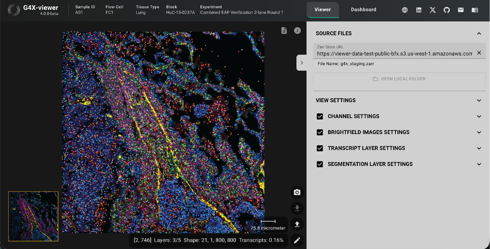

 
# :material-magnify: G4X-viewer
<a href="https://g4x-viewer.singulargenomics.com">g4x-viewer.singulargenomics.com</a>
 

#### Explore G4X-data

---

 

G4X-viewer is an open-source, browser-based application for interactive visualization of [G4X-data](https://docs.singulargenomics.com/g4x_data/). Explore tissue images, transcripts, and segmented cells, adjust layer visibility, filter cells, and capture screenshots of features of interest. The available layers depend on the data included in your sample.

Use regions of interest (ROIs) to compare selected areas of your sample in the dashboard and export data for further analysis. Transcript display controls let you adjust how many transcripts are rendered while exploring large datasets.

Use the [hosted application](https://g4x-viewer.singulargenomics.com), or run the same web application locally using the instructions in the [GitHub repository](https://github.com/Singular-Genomics/G4X-viewer#getting-started).

!!! tip "Data compatibility"
    G4X-viewer v4 uses the `g4x-viewer.zarr` store. For older datasets that use separate viewer files, use the [legacy viewer](https://g4x-viewer.legacy.singulargenomics.com), or use [G4X-helpers migrate](https://docs.singulargenomics.com/G4X-helpers/features/migrate/) to convert supported legacy data and generate a v4-compatible viewer store.
 

### [viewer](viewer/index.md)
---

Start with the [viewer guide](viewer/index.md) to learn how to load your sample and use the controls for each data layer.

The viewer pages include:

+ loading source data
+ on-screen controls
+ protein layer controls
+ fH&E layer controls
+ transcript layer controls
+ segmentation layer controls
+ UMAP cell filter
+ flow cytometry cell filter

 

### [dashboard](dashboard/index.md)
---

Use the [dashboard guide](dashboard/index.md) to compare transcript, cell, and protein information across selected ROIs. The viewer and dashboard share the same session, so you can switch between spatial exploration and ROI comparisons. Available plots depend on the data in your sample.

The dashboard pages include:

+ ROI selection guide
+ expression box charts
+ pie charts
+ expression bar charts
+ heatmap charts

 

### [resources](resources.md)
---

See [resources](./resources.md) for video tutorials and introductory slides. Some resources demonstrate earlier viewer versions, so controls and supported data formats may differ from v4.

 

### support
---

Got feedback or ideas for additional tutorials?  
:material-arrow-right-thin: drop us a note at [care@singulargenomics.com](mailto:care@singulargenomics.com).  

Found a bug or want to report another problem regarding G4X-viewer?  
:material-arrow-right-thin: please file a new issue on the G4X-viewer [issue tracker](https://github.com/Singular-Genomics/G4X-viewer/issues)  

Want to get involved and add new features?  
:material-arrow-right-thin: check out how to [contribute](contributing.md).

--8<-- "_core/_partials/end_cap.md"
