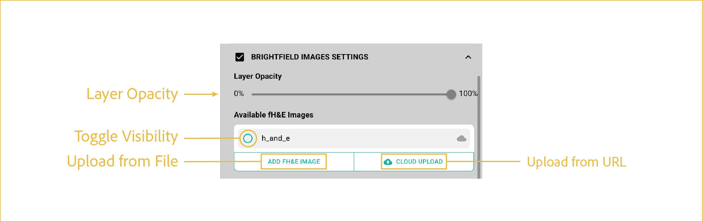

# fH&E layer

---

 

This section describes how to load, display, and adjust the fH&E image layer.

## reference image

 

These controls manage the single fH&E image supplied by the dataset. The top of **Multi-Channel** contains one row with an **fH&E** toggle, an **Opacity** slider, and an editable percentage value.

## features

- <b><u>fH&E:</u></b>

      Enables or disables the dataset's fH&E image. The image is selected on first enable; disabling it hides it while retaining the loaded image and its opacity setting. The toggle is disabled when no image is available.

- <b><u>Opacity:</u></b>

      Adjusts transparency from **0%** (fully transparent) to **100%** (fully opaque). Use the slider or type a percentage and press Enter or leave the field. Opacity controls are disabled while the image is off. Values are restored when the image is enabled again.

The image is supplied through Source Data; there are no separate image-selection, Add Image, or Cloud Upload controls in these controls.

 

--8<-- "_core/_partials/end_cap.md"
